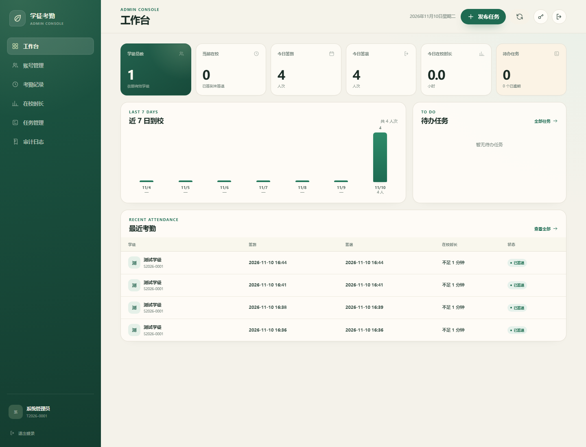

# 学徒考勤系统

一套基于 MySQL 的学徒考勤与任务管理系统，包含学徒端、管理员后台、账号体系、在校时长统计和任务管理。

## 界面预览




## 快速启动

### 1. 确认 MySQL 服务

MySQL 8.4.9 已安装为 Windows 服务 `MySQL84`，默认仅监听：

```text
127.0.0.1:3306
```

可在“服务”中确认 `MySQL84` 正在运行。

### 2. 启动网站

双击 `start.bat`，脚本会启动 Node 服务并打开：

```text
http://localhost:8080
```

关闭启动窗口即可停止网站。MySQL 服务独立运行，不受影响。

### 从压缩包部署到新电脑

完整运行包已经带有 Node 运行时和依赖，但 MySQL 需要目标电脑自行安装并启动。第一次部署时：

1. 安装 MySQL 8.4 LTS，并确保 `MySQL84` 服务正在运行；
2. 双击 `setup-database.bat`，按提示输入 MySQL root 密码；
3. 脚本会创建数据库、应用账号、执行表结构迁移，并写入 `config/database.env`；
4. 双击 `start.bat`；
5. 首次打开页面时创建管理员账号。

更详细的中文步骤见压缩包内的 `使用说明.txt`。

### 3. 登录

- 管理员使用工号登录，例如 `T2026-0001`；
- 学徒使用管理员注册后分发的学号登录，例如 `S2026-0001`；
- 初始管理员账号和密码由部署时提供，请在登录后立即修改密码。

## 功能

### 学徒端

- 使用学号/工号 + 密码登录；
- 首次登录强制修改初始密码；
- 到校签到、离校签退，自动记录服务器时间；
- 浏览器定位、地图显示、地址与定位精度留痕；
- 自动计算每次在校时长与本周累计在校时长；
- 查看自己的考勤记录，按时间、状态、地点筛选；
- 查看、开始、完成管理员发布的任务；
- 导出个人考勤 CSV；
- 修改自己的登录密码。

### 管理员后台

- 工作台：学徒总数、当前在校、今日签到/签退、今日在校总时长、待办任务；
- 账号管理：注册学徒/管理员账号，自动分发学号/工号，停用/启用账号，重置密码；
- 考勤记录：查看全部记录，按日期、状态、姓名/编号/地点筛选，作废异常记录，导出 CSV；
- 在校时长：按学徒汇总指定日期范围内的在训次数、累计时长、最近到校时间；
- 任务管理：向学徒发布任务，设置优先级和截止时间，查看进行中/已完成/逾期状态，取消任务；
- 审计日志：查看账号、考勤、任务等关键操作记录。

## 账号与编号规则

- 学徒账号：`S{年份}-{4位序号}`，例如 `S2026-0001`；
- 管理员/教职工账号：`T{年份}-{4位序号}`，例如 `T2026-0001`；
- 编号由数据库中的 `xt_number_sequences` 在事务内分配，避免并发重复；
- 账号由管理员注册，不开放自行注册；
- 初始密码由管理员设置或系统随机生成，首次登录必须修改；
- 数据库不保存明文密码，使用 Node `crypto.scrypt` 加盐哈希。

## 技术架构

```text
浏览器（HTML / CSS / JavaScript）
        │ 同源 Cookie Session
        ▼
Node.js + Express 5
        │ mysql2 连接池
        ▼
MySQL 8.4.9
```

- 前端无构建步骤，静态文件位于 `public/`；
- 后端入口为 `server.js`，业务代码位于 `server/`；
- 登录会话保存在 `xt_sessions` 表，Cookie 为 `HttpOnly + SameSite=Lax`；
- 登录失败次数、账号锁定和登录尝试记录保存在 `xt_login_attempts` / `xt_accounts`；
- 所有时间按 UTC 存储，界面按浏览器本地时区显示；
- 数据库结构见 [database/README.md](database/README.md)。

## 文件结构

```text
签到系统/
├─ public/
│  ├─ index.html       学徒工作台
│  ├─ app.js
│  ├─ admin.html       管理员后台
│  ├─ admin.js
│  ├─ admin.css
│  ├─ login.html       登录 / 初始化页
│  ├─ login.js
│  ├─ login.css
│  ├─ styles.css
│  ├─ dashboard.css
│  ├─ map.js
│  └─ favicon.svg
├─ server/
│  ├─ config.js        数据库配置读取
│  ├─ db.js            MySQL 连接池
│  ├─ security.js      密码、Token、时间、CSV 工具
│  ├─ auth.js          登录、Session、权限
│  └─ api.js           考勤、任务、管理员 API
├─ database/
│  ├─ 001_init.sql
│  ├─ 002_tasks.sql
│  └─ README.md
├─ config/
│  └─ database.env.example
├─ server.js           Express 服务和页面路由
├─ setup-database.bat  新电脑数据库初始化
├─ setup-database.ps1
├─ start.bat
├─ package.json
├─ 使用说明.txt
└─ README.md
```

## 数据库账号

应用配置按以下顺序读取：

```text
1. 环境变量 APP_DB_ENV 指向的文件
2. 项目目录 config/database.env
3. C:\ProgramData\ApprenticeAttendance\config\database.env
```

转发包使用 `config/database.env`，由 `setup-database.bat` 自动生成；本机开发环境使用第三个路径。

数据库账号：

| 账号 | 用途 |
| --- | --- |
| `attendance_app` | 网站运行账号，只有业务表的增删改查权限 |
| `attendance_admin` | 数据库结构管理 / SQLPro 使用 |
| `root` | 本机维护 |

root 和数据库管理员密码位于：

```text
C:\ProgramData\ApprenticeAttendance\secrets\
```

这些文件不在 `public/` 中，不会被静态服务器访问。

## 定位与地图

- 浏览器原生 `navigator.geolocation.getCurrentPosition`；
- 底图默认 OpenStreetMap.de，失败时自动回退 Esri World Street Map；
- 地址由 BigDataCloud Reverse Geocode API 解析；
- 地图和地址解析需要网络，定位失败时仍可完成签到/签退，只是不保存位置；
- 多设备通过局域网访问时，浏览器定位要求 HTTPS（`localhost` 除外）。

## 安全说明

- 密码使用 `scrypt` 加盐哈希；
- 会话 Token 只保存 SHA-256 哈希，Cookie 设置 `HttpOnly`；
- 管理员接口进行角色校验；
- 修改密码、重置密码会撤销其他会话；
- 登录失败 5 次会临时锁定账号，登录尝试也会记录 IP；
- 写操作校验请求来源；
- 静态目录只暴露 `public/`，数据库配置和密钥不在网站目录。

## 备份

建议定期备份数据库：

```powershell
$env:MYSQL_PWD = ((Get-Content 'C:\ProgramData\ApprenticeAttendance\secrets\mysql-root.txt' |
  Where-Object { $_ -like 'password=*' }) -split '=',2)[1]
& 'C:\Program Files\MySQL\MySQL Server 8.4\bin\mysqldump.exe' `
  --protocol=TCP -h 127.0.0.1 -P 3306 -u root --single-transaction `
  apprentice_attendance > 'C:\ProgramData\ApprenticeAttendance\backups\attendance.sql'
Remove-Item Env:MYSQL_PWD
```

## 常见问题

**页面打不开？**  
确认 `MySQL84` 服务和 Node 启动窗口都在运行，然后访问 `http://localhost:8080`。

**登录提示账号或密码错误？**  
使用管理员分发的学号/工号；首次登录需要修改初始密码。连续失败 5 次会锁定 15 分钟。

**地图空白？**  
通常是网络无法访问 OpenStreetMap / Esri 瓦片，考勤数据不受影响。

**需要远程访问 MySQL？**  
当前只监听 `127.0.0.1`。不要直接把 3306 暴露到公网，建议使用 VPN、SSH 隧道，或将网站和数据库部署在同一内网服务器。

## 当前范围

系统已具备可运行的账号、考勤、时长和任务闭环。若用于正式多校区部署，建议继续补充：

- HTTPS 证书和反向代理；
- 定期自动备份与监控；
- 批量导入学徒名单；
- 更细的任务审核、评论与附件；
- 地理围栏校验和异常考勤审批。
